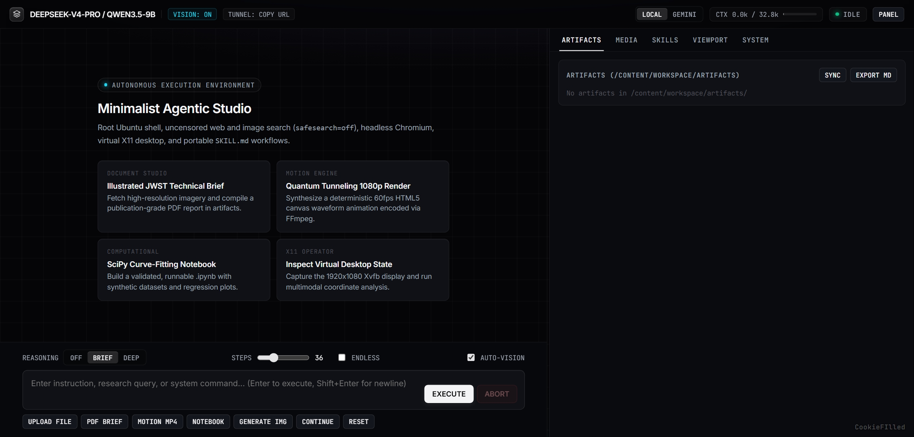
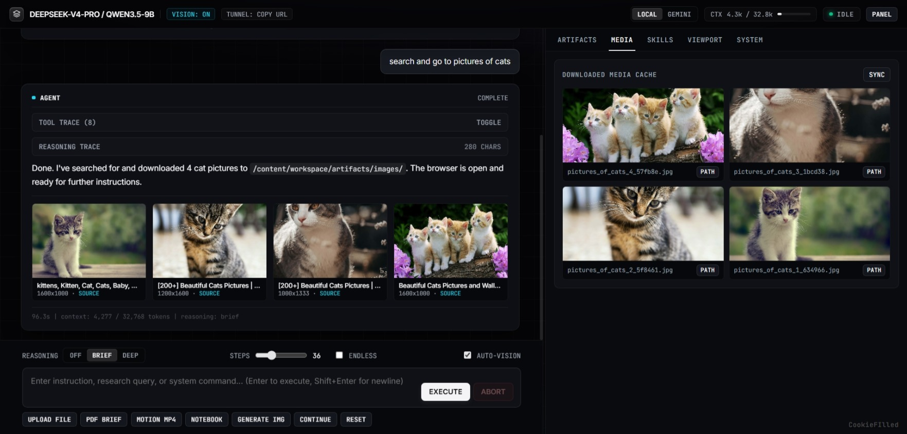
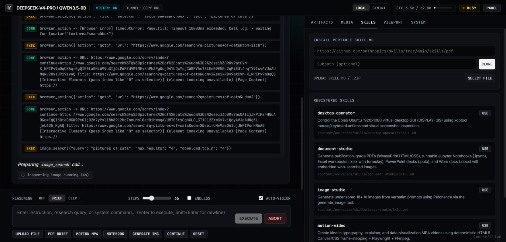
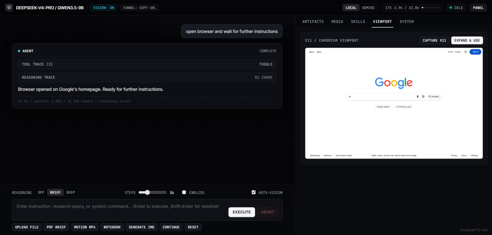
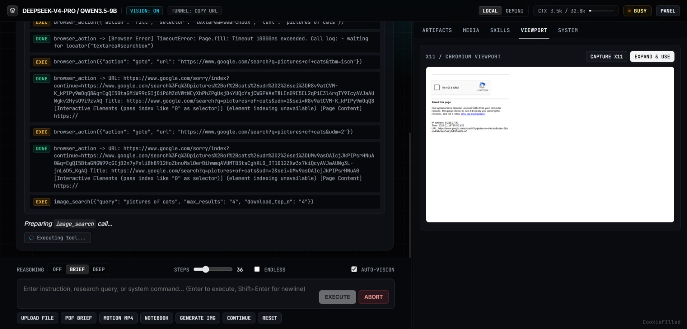
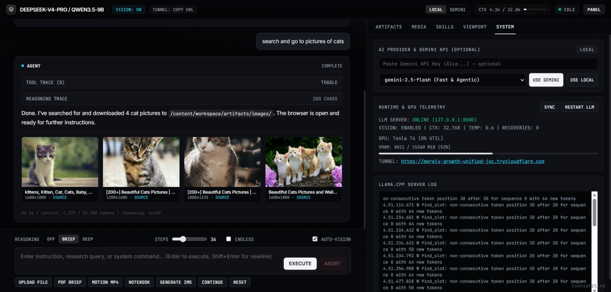

<p align="center">
  
</p>

<h1 align="center">DeepSeek-V4-Pro / Qwen3.5 Local Autonomous Agentic Workspace</h1>

<p align="center">
  <strong>A fully autonomous, local-first AI agent studio that runs on your own hardware — or bridges to Gemini API — with a sleek web UI, persistent model caching, headless browser control, desktop automation, and portable SKILL.md workflows.</strong>
</p>

<p align="center">
  <a href="#-quick-start"></a>
  <a href="#-features"></a>
  <a href="#-architecture"></a>
  <a href="LICENSE"></a>
  
</p>

---

## Table of Contents

- [Overview](#-overview)
- [Features](#-features)
- [Screenshots](#-screenshots)
- [Architecture](#-architecture)
- [Quick Start](#-quick-start)
- [Configuration](#%EF%B8%8F-configuration)
- [Usage](#-usage)
- [Agent Tools](#-agent-tools)
- [Portable SKILL.md System](#-portable-skillmd-system)
- [Project Structure](#-project-structure)
- [CI/CD](#-cicd)
- [Contributing](#-contributing)
- [License](#-license)

---

## Overview

This project is a **self-contained, local-first agentic AI workspace** that lets you run an autonomous AI agent entirely on your own PC — no cloud dependency required. It downloads and runs a quantized GGUF model (DeepSeek-V4-Pro / Qwen3.5-9B) via **llama.cpp**, or can optionally route to **Google Gemini API** for cloud-powered inference.

The agent can:
- Execute shell commands, write and edit files
- Search the web and fetch pages
- Drive a headless Chromium browser
- Control your desktop (screenshots, mouse, keyboard)
- Generate AI images
- Produce deliverables: PDFs, Word docs, PowerPoint, Excel, Jupyter Notebooks, MP4 videos
- Follow reusable, portable `SKILL.md` instruction workflows

Everything runs through a polished, dark-themed web UI served locally on `http://127.0.0.1:7860`.

---

## Features

### Dual AI Provider System
- **Local Mode**: Runs entirely offline using llama.cpp with a GGUF-quantized model (Q4_K_M by default). Models are **downloaded once** and persistently cached — no re-downloading across restarts.
- **Gemini Mode**: Switch to Google Gemini API (2.5 Flash / 2.5 Pro / 2.0 Flash) with a single click in the UI. No local GPU required.
- **Hot-swappable**: Switch between Local and Gemini mid-session from the top bar or System tab.

### Autonomous Agent Loop
- Multi-step autonomous execution with configurable step limits (4–120 or Endless mode)
- Three reasoning modes: **Off** (direct answers), **Brief** (budgeted thinking), **Deep** (extended chain-of-thought)
- Automatic context compaction when the conversation grows beyond the context window
- Rolling history management with smart trimming of old tool outputs
- Auto-healing: if the llama.cpp server crashes, the watchdog restarts it and resumes

### 11 Built-in Agent Tools
| Tool | Description |
|------|-------------|
| `web_search` | Uncensored web search (safesearch=off) via DuckDuckGo / Brave fallback |
| `fetch_url` | Fast HTTP page fetch with clean markdown extraction |
| `image_search` | Uncensored image search with automatic downloading and verification |
| `generate_image` | AI image generation via Perchance / Pollinations fallback |
| `view_image` | Vision model inspection of local images or screenshots |
| `run_bash` | Cross-platform shell execution (PowerShell on Windows, Bash on Linux/macOS) |
| `file_ops` | Read, write, append, edit, and list files in the workspace |
| `browser_action` | Headless Chromium: navigate, click, fill forms, scroll, run JS, take screenshots, render deterministic MP4 videos |
| `desktop_action` | Native desktop control via PyAutoGUI/mss or Xvfb virtual display |
| `activate_skill` | Load a portable SKILL.md workflow |
| `install_skill` | Install skills from GitHub repos |

### Persistent Model Cache
- Models are downloaded once from Hugging Face and stored in `./models/`
- A manifest tracks repo, quantization, and file paths
- On next run, cached models are detected instantly — zero network calls
- Supports custom model paths via environment variables

### Web Studio UI
- Dark, minimalist design with ambient gradients and glass-morphism effects
- Real-time SSE streaming of agent output with tool execution logs
- Markdown rendering with syntax highlighting (highlight.js), LaTeX math (KaTeX), and code copy buttons
- Resizable split-pane layout: Chat + Inspector (Artifacts, Media, Skills, Viewport, System)
- Built-in file upload, chat export, session reset
- Quick presets for common tasks (PDF report, Motion MP4, Jupyter Notebook, Desktop Inspect, Image Generation)

### Virtual Desktop & VNC (Linux)
- Optional Xvfb + Fluxbox + x11vnc virtual display on headless Linux servers
- noVNC web-based VNC viewer with WebSocket proxy built into the FastAPI server
- Full interactive X11 control via xdotool

### Cloudflare Quick Tunnel
- One-flag (`--tunnel`) public HTTPS access via Cloudflare Quick Tunnel
- Auto-detects the generated URL from cloudflared logs

---

## Screenshots

### Studio Dashboard
The main workspace — a split-pane interface with the agent chat on the left and an inspector panel on the right for artifacts, media, skills, viewport, and system telemetry.

<p align="center">
  
</p>

### Media Cache
Downloaded and generated images are cached locally and displayed in a grid gallery. Every image the agent fetches or creates is saved persistently.

<p align="center">
  
</p>

### Skills Manager
Install portable `SKILL.md` workflows from GitHub or upload them directly. Skills are reusable instruction bundles that extend the agent's capabilities.

<p align="center">
  
</p>

### X11 Virtual Desktop Viewport
On Linux, enable a virtual desktop environment with Xvfb and interact with GUI applications through the built-in noVNC viewer.

<p align="center">
  
</p>

### Headless Browser Automation
The agent drives a headless Chromium browser — navigating pages, clicking interactive elements by index, filling forms, and capturing screenshots.

<p align="center">
  
</p>

### System Telemetry
Monitor the runtime: GPU name, VRAM usage, llama.cpp server status, model cache state, context window utilization, and live server logs.

<p align="center">
  
</p>

---

## Architecture

```
                    ┌──────────────────────────────────────────────────────┐
                    │                   Web Browser (UI)                  │
                    │            http://127.0.0.1:7860                    │
                    └────────────────────────┬─────────────────────────────┘
                                             │ HTTP / SSE / WebSocket
                    ┌────────────────────────▼─────────────────────────────┐
                    │              FastAPI Studio Server                   │
                    │  (server.py — REST API, SSE streaming, file         │
                    │   serving, Cloudflare tunnel, noVNC proxy)          │
                    └───┬──────┬──────┬───────┬───────┬──────┬────────────┘
                        │      │      │       │       │      │
              ┌─────────▼┐  ┌──▼───┐ ┌▼─────┐ ┌▼─────┐ ┌▼────┐ ┌▼─────────┐
              │  Agent    │  │Model │ │Skill │ │Brows.│ │Desk.│ │  Config   │
              │  Engine   │  │Cache │ │Mgr   │ │Work. │ │Oper.│ │  (.env)   │
              │(agent.py) │  │Mgr   │ │      │ │      │ │     │ │           │
              └─────┬─────┘  └──┬───┘ └──────┘ └──┬───┘ └──┬──┘ └───────────┘
                    │           │                  │        │
              ┌─────▼─────┐  ┌──▼──────────────┐  │   ┌────▼─────────┐
              │  Toolkit   │  │  llama.cpp /    │  │   │ PyAutoGUI /  │
              │ (tools.py) │  │  llama-cpp-py   │  │   │ mss / Xvfb   │
              │ 11 tools   │  │  Local Server   │  │   │ + xdotool    │
              └────────────┘  └──┬──────────────┘  │   └──────────────┘
                                 │                 │
                    ┌────────────▼──┐  ┌───────────▼──────────┐
                    │  GGUF Model   │  │  Playwright Chromium  │
                    │  (./models/)  │  │  (Headless Browser)   │
                    └───────────────┘  └──────────────────────┘
```

**Key modules:**

| Module | File | Purpose |
|--------|------|---------|
| **Config** | `config.py` | Cross-platform configuration from `.env`, CLI flags, and runtime overrides |
| **Model Cache** | `models.py` | Persistent GGUF model downloading, manifest tracking, and cache validation |
| **LLM Server** | `llm_server.py` | llama.cpp server lifecycle management, GPU detection, watchdog auto-restart |
| **Agent Engine** | `agent.py` | Autonomous execution loop, context compaction, dual-provider streaming |
| **Toolkit** | `tools.py` | All 11 agent tools: shell, files, search, browser, desktop, vision, skills |
| **Browser Worker** | `browser.py` | Playwright Chromium automation, DOM indexing, video rendering, Perchance image gen |
| **Desktop Operator** | `desktop.py` | Cross-platform desktop screenshots and GUI control |
| **Skills Manager** | `skills.py` | SKILL.md parsing, built-in starter skills, GitHub/ZIP installation |
| **Studio Server** | `server.py` | FastAPI web backend, SSE streaming, REST API, noVNC proxy, Cloudflare tunnel |
| **Entrypoint** | `run.py` | Unified CLI with argument parsing, server boot, and browser auto-open |

---

## Quick Start

### Prerequisites

- **Python 3.10+** (3.11 recommended)
- **Git** (for cloning and skill installation)
- **GPU (optional)**: NVIDIA GPU with CUDA for accelerated local inference, or Apple Silicon (Metal). CPU-only mode is also supported.

### 1. Clone the Repository

```bash
git clone https://github.com/CookieFilled/deepseek-qwen35-local-workspace.git
cd deepseek-qwen35-local-workspace
```

### 2. Run Setup

**Windows:**
```cmd
setup.bat
```

**Linux / macOS:**
```bash
chmod +x setup.sh
./setup.sh
```

This creates a virtual environment, installs all dependencies, sets up Playwright Chromium, and generates a `.env` file from `.env.example`.

> Use `setup.bat --minimal` or `./setup.sh --minimal` to install only core dependencies (no browser automation, desktop control, or document generation).

### 3. Launch the Studio

**Option A — Gemini API (no local model, no GPU needed):**
```bash
# Windows
start.bat --provider gemini --gemini-key YOUR_GEMINI_API_KEY

# Linux / macOS
./start.sh --provider gemini --gemini-key YOUR_GEMINI_API_KEY
```

**Option B — Local inference (downloads model once, requires ~6GB disk):**
```bash
# Windows
start.bat --provider local

# Linux / macOS
./start.sh --provider local
```

The Studio UI opens automatically at **http://127.0.0.1:7860**.

### 4. Pre-download Model (Optional)

```bash
python run.py --download-only
```
Downloads and caches the GGUF model without starting the server. Useful for first-time setup on slow connections.

---

## Configuration

All settings are configured via environment variables in `.env` (copied from `.env.example`) or CLI flags.

### Key Environment Variables

| Variable | Default | Description |
|----------|---------|-------------|
| `LLM_PROVIDER` | `local` | AI provider: `local` (llama.cpp) or `gemini` (Google API) |
| `GEMINI_API_KEY` | _(empty)_ | Your Gemini API key (required only for Gemini mode) |
| `GEMINI_MODEL` | `gemini-2.5-flash` | Gemini model to use |
| `MODELS_DIR` | `./models` | Persistent directory for cached GGUF models |
| `MODEL_REPO` | `mradermacher/DeepSeek-V4-Pro-Qwen3.5-9B-...` | Hugging Face repository for the model |
| `QUANTIZATION` | `Q4_K_M` | GGUF quantization level |
| `CONTEXT_SIZE` | `32768` | Context window size for local inference |
| `TEMPERATURE` | `0.6` | Sampling temperature |
| `GPU_LAYERS` | `-1` | GPU layers to offload (`-1` = all, `0` = CPU only) |
| `SERVER_HOST` | `127.0.0.1` | Studio server host |
| `SERVER_PORT` | `7860` | Studio server port |
| `BROWSER_HEADLESS` | `true` | Run Playwright Chromium in headless mode |
| `ENABLE_CLOUDFLARE_TUNNEL` | `false` | Expose the Studio via a public Cloudflare URL |
| `ENABLE_VIRTUAL_DESKTOP` | `false` | Enable Xvfb + VNC virtual desktop (Linux only) |

### CLI Flags

```
python run.py [OPTIONS]

--provider {local,gemini}    Active AI provider
--gemini-key KEY             Gemini API key
--gemini-model MODEL         Gemini model ID (e.g. gemini-2.5-flash)
--skip-local-model           Start UI without downloading/booting local model
--download-only              Download model once, then exit
--model-path PATH            Path to an existing local .gguf model
--mmproj-path PATH           Path to an existing local mmproj .gguf
--host HOST                  Server host (default: 127.0.0.1)
--port PORT                  Server port (default: 7860)
--tunnel                     Enable Cloudflare Quick Tunnel
--virtual-desktop            Enable Xvfb + VNC virtual desktop (Linux)
--open-browser               Auto-open the Studio in your default browser
```

---

## Usage

### Chat Interface

Type your instructions in the chat box and press **Enter** (or click **EXECUTE**). The agent will autonomously plan and execute multi-step tasks, calling tools as needed.

**Controls:**
- **Reasoning Mode**: `OFF` / `BRIEF` / `DEEP` — controls how much chain-of-thought the agent uses
- **Steps Slider**: limits the number of tool-call rounds (4–120, or check `ENDLESS`)
- **Auto-Vision**: automatically describe screenshots/images after browser and desktop actions
- **ABORT**: cancel the agent mid-execution
- **RESET**: clear the conversation and start fresh

### Quick Presets

Click the preset cards on the welcome screen or the bottom quick-strip:
- **PDF BRIEF** — Generate an illustrated PDF report with web-searched images
- **MOTION MP4** — Render a deterministic HTML5 canvas animation as an H.264 video
- **NOTEBOOK** — Build a validated, runnable Jupyter Notebook with plots
- **GENERATE IMG** — Create an AI image from a text prompt
- **DESKTOP INSPECT** — Capture and analyze the local desktop screen

### Inspector Panel

The right-side panel has five tabs:

| Tab | Purpose |
|-----|---------|
| **ARTIFACTS** | Generated files (PDFs, videos, documents) with preview and download |
| **MEDIA** | Downloaded/generated images in a grid gallery |
| **SKILLS** | Install and manage portable SKILL.md workflows |
| **VIEWPORT** | Live desktop/browser screenshot viewer and VNC control |
| **SYSTEM** | AI provider config, model cache status, GPU telemetry, server logs |

---

## Agent Tools

### Shell Execution (`run_bash`)
Runs any shell command in the workspace directory. Uses PowerShell on Windows, Bash on Linux/macOS. Supports timeouts and captures both stdout and stderr.

### File Operations (`file_ops`)
Full filesystem access within the workspace: read, write, append, targeted search-and-replace edits, and directory listing.

### Web Search (`web_search`)
Uncensored web search using DuckDuckGo with automatic Brave fallback. Returns titles, URLs, and snippets.

### Page Fetching (`fetch_url`)
Fast HTTP fetch of any URL with automatic HTML-to-markdown conversion using BeautifulSoup + markdownify.

### Image Search (`image_search`)
Finds images across DuckDuckGo and Bing with safesearch disabled. Downloads and validates top results as local JPEG files.

### Image Generation (`generate_image`)
Generates AI images using Perchance's text-to-image generator via headless browser automation, with Pollinations API as fallback.

### Vision (`view_image`)
Sends a local image to the vision model (local mmproj or Gemini) and returns a text description. Supports coordinate grid overlay for desktop screenshots.

### Browser Automation (`browser_action`)
Full Playwright Chromium automation: navigation, indexed DOM element clicking, form filling, scrolling, JavaScript evaluation, screenshots, and deterministic frame-by-frame MP4 video rendering.

### Desktop Control (`desktop_action`)
Cross-platform desktop automation using PyAutoGUI and mss for native Windows/macOS/Linux, or xdotool for Xvfb virtual displays.

### Skills (`activate_skill` / `install_skill`)
Load or install portable SKILL.md instruction bundles that teach the agent specialized workflows.

---

## Portable SKILL.md System

Skills are reusable, portable instruction files that extend the agent with domain-specific knowledge. Each skill is a folder containing a `SKILL.md` with YAML frontmatter:

```markdown
---
name: my-custom-skill
description: A brief description of what this skill does.
---
# My Custom Skill

Step-by-step instructions the agent follows when this skill is activated...
```

### Built-in Starter Skills

| Skill | Description |
|-------|-------------|
| `motion-video` | Create kinetic typography and motion graphics MP4 videos via HTML5 Canvas + FFmpeg |
| `document-studio` | Generate PDFs (WeasyPrint), Jupyter Notebooks, Excel, PowerPoint, and Word docs |
| `web-researcher` | Deep multi-source web and image research with structured extraction |
| `desktop-operator` | Local PC desktop control via screenshots and GUI automation |
| `image-studio` | AI image generation with uncensored prompts |

### Installing Skills

**From GitHub:**
```
Paste a GitHub URL in the Skills tab → Click CLONE
```

**From file upload:**
```
Upload a SKILL.md or .zip bundle via the Skills tab
```

**Via the agent:**
```
Ask: "Install the skill from https://github.com/user/repo/tree/main/skills/my-skill"
```

---

## Project Structure

```
deepseek-qwen35-local-workspace/
├── run.py                          # Unified CLI entrypoint
├── pyproject.toml                  # Package metadata and dependencies
├── requirements.txt                # Core dependencies
├── requirements-full.txt           # Full dependencies (browser, desktop, docs)
├── setup.bat / setup.sh            # One-command setup scripts
├── start.bat / start.sh            # Quick launch scripts
├── .env.example                    # Configuration template
├── .gitignore                      # Git ignore rules
├── LICENSE                         # MIT License
│
├── agentic_workspace/              # Main Python package
│   ├── __init__.py                 # Package version
│   ├── config.py                   # Configuration & path management
│   ├── models.py                   # Persistent GGUF model cache
│   ├── llm_server.py               # llama.cpp server lifecycle manager
│   ├── agent.py                    # Autonomous agent execution engine
│   ├── tools.py                    # 11 agent tools implementation
│   ├── browser.py                  # Playwright Chromium worker
│   ├── desktop.py                  # Cross-platform desktop operator
│   ├── skills.py                   # SKILL.md manager & built-in skills
│   ├── server.py                   # FastAPI web server & REST API
│   └── static/
│       └── index.html              # Studio web UI (single-file SPA)
│
├── assets/                         # Repository screenshots
│   ├── 01-studio-dashboard.jpg
│   ├── 02-media-cache.jpeg
│   ├── 03-skills-manager.jpeg
│   ├── 04-x11-viewport.jpg
│   ├── 05-browser-automation.jpeg
│   └── 06-system-telemetry.jpeg
│
└── .github/
    └── workflows/
        └── ci.yml                  # GitHub Actions CI pipeline
```

**Runtime directories** (auto-created, git-ignored):
- `models/` — Cached GGUF model files
- `workspace/` — Agent working directory (artifacts, screenshots, uploads, skills)
- `logs/` — Server and tunnel logs
- `bin/` — Optional local binaries (llama-server, cloudflared)

---

## CI/CD

The project includes a GitHub Actions CI pipeline (`.github/workflows/ci.yml`) that runs on every push and pull request to `main`/`master`:

1. **Sets up Python 3.11**
2. **Installs core dependencies** from `requirements.txt`
3. **Byte-compiles** all Python source files
4. **Import checks** — verifies that `WorkspaceConfig`, `StudioRuntime`, and `create_app` can be imported and instantiated successfully

---

## Contributing

Contributions are welcome! Here's how to get started:

1. **Fork** the repository
2. **Create a feature branch**: `git checkout -b feature/my-feature`
3. **Make your changes** and test locally
4. **Commit**: `git commit -m "feat: add my feature"`
5. **Push**: `git push origin feature/my-feature`
6. **Open a Pull Request**

### Development Setup

```bash
git clone https://github.com/CookieFilled/deepseek-qwen35-local-workspace.git
cd deepseek-qwen35-local-workspace
python -m venv .venv
source .venv/bin/activate   # or .venv\Scripts\activate on Windows
pip install -r requirements-full.txt
python -m playwright install chromium
cp .env.example .env
python run.py --provider gemini --gemini-key YOUR_KEY --open-browser
```

---

## License

This project is licensed under the **MIT License** — see the [LICENSE](LICENSE) file for details.

Copyright (c) 2026 CookieFilled

---

<p align="center">
  <sub>Built with llama.cpp, FastAPI, Playwright, and a lot of autonomous tool calls.</sub>
</p>
